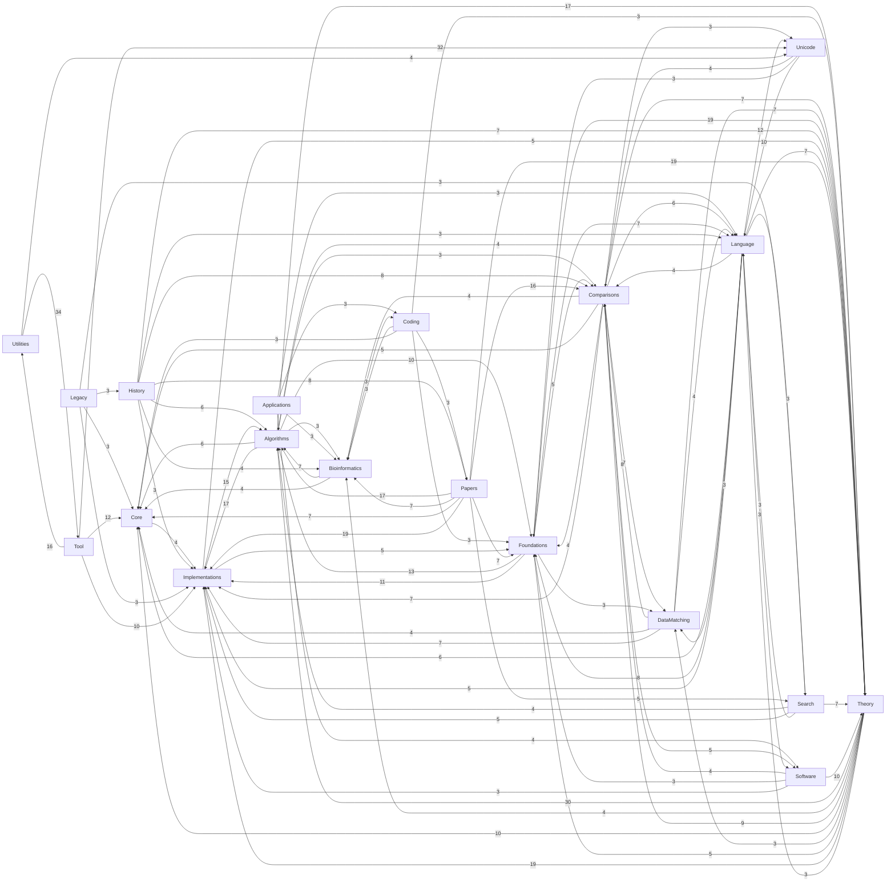

# Sơ đồ Internal Link toàn site — hiện trạng và đề xuất

Snapshot: 528b3f6539411d1629164ddd7460d6a4ac0fafb3

{
  "knowledge_pages": 91,
  "tool_nodes": 17,
  "readable": 108,
  "preview_tools": 7,
  "production_tools": 10,
  "unavailable": [],
  "occurrences": 7474,
  "unique_pairs": 5129,
  "semantic_pairs": 1195,
  "contextual_pairs": 869,
  "unmapped_occurrences": 0,
  "proposals": 220,
  "proposed_missing_semantic": 100
}

**Phân biệt** contextual, main_content, listing_related với header/sidebar/footer/breadcrumb/navigation. Ma trận chỉ đếm cặp URL khác nhau ở 3 nhóm nội dung đầu, không chứng minh relevance của từng link. Tool Production chỉ đọc. Link ngoài manifest lưu riêng.

## Sơ đồ hiện trạng theo cụm

Chỉ hiện cạnh liên cụm >=3 cặp để dễ đọc; bảng và CSV giữ đủ cạnh.

| Nguồn | Đích | Cặp semantic |
| --- | --- | --- |
| Algorithms | Algorithms | 36 |
| Algorithms | Bioinformatics | 3 |
| Algorithms | Comparisons | 3 |
| Algorithms | Core | 6 |
| Algorithms | Foundations | 10 |
| Algorithms | Implementations | 17 |
| Algorithms | Language | 1 |
| Algorithms | Papers | 2 |
| Algorithms | Search | 1 |
| Algorithms | Theory | 17 |
| Applications | Bioinformatics | 3 |
| Applications | Coding | 3 |
| Applications | Language | 3 |
| Applications | Software | 4 |
| Applications | Unicode | 2 |
| Bioinformatics | Algorithms | 7 |
| Bioinformatics | Bioinformatics | 16 |
| Bioinformatics | Coding | 3 |
| Bioinformatics | Core | 4 |
| Bioinformatics | Foundations | 2 |
| Bioinformatics | Implementations | 1 |
| Bioinformatics | Papers | 1 |
| Bioinformatics | Theory | 2 |
| Coding | Algorithms | 1 |
| Coding | Bioinformatics | 3 |
| Coding | Coding | 9 |
| Coding | Comparisons | 1 |
| Coding | Core | 3 |
| Coding | Foundations | 3 |
| Coding | History | 2 |
| Coding | Papers | 3 |
| Coding | Theory | 3 |
| Comparisons | Bioinformatics | 4 |
| Comparisons | Coding | 1 |
| Comparisons | Comparisons | 37 |
| Comparisons | Core | 5 |
| Comparisons | DataMatching | 7 |
| Comparisons | Foundations | 4 |
| Comparisons | Implementations | 7 |
| Comparisons | Language | 6 |
| Comparisons | Search | 1 |
| Comparisons | Software | 5 |
| Comparisons | Theory | 7 |
| Comparisons | Unicode | 3 |
| Core | Algorithms | 1 |
| Core | Applications | 1 |
| Core | Comparisons | 1 |
| Core | Foundations | 2 |
| Core | History | 1 |
| Core | Implementations | 4 |
| Core | Papers | 1 |
| Core | Theory | 1 |
| Core | Unicode | 1 |
| Core | Utilities | 1 |
| DataMatching | Comparisons | 8 |
| DataMatching | Core | 4 |
| DataMatching | DataMatching | 16 |
| DataMatching | Implementations | 7 |
| DataMatching | Language | 4 |
| DataMatching | Software | 1 |
| DataMatching | Theory | 7 |
| Foundations | Algorithms | 13 |
| Foundations | Bioinformatics | 2 |
| Foundations | Coding | 1 |
| Foundations | Comparisons | 5 |
| Foundations | Core | 2 |
| Foundations | DataMatching | 3 |
| Foundations | Foundations | 25 |
| Foundations | Implementations | 11 |
| Foundations | Language | 7 |
| Foundations | Search | 1 |
| Foundations | Software | 1 |
| Foundations | Theory | 19 |
| Foundations | Unicode | 2 |
| History | Algorithms | 6 |
| History | Bioinformatics | 4 |
| History | Coding | 2 |
| History | Comparisons | 8 |
| History | Core | 2 |
| History | DataMatching | 1 |
| History | History | 4 |
| History | Implementations | 3 |
| History | Language | 3 |
| History | Papers | 8 |
| History | Search | 1 |
| History | Software | 2 |
| History | Theory | 7 |
| Implementations | Algorithms | 15 |
| Implementations | Comparisons | 1 |
| Implementations | Core | 2 |
| Implementations | DataMatching | 1 |
| Implementations | Foundations | 5 |
| Implementations | Implementations | 13 |
| Implementations | Language | 1 |
| Implementations | Search | 1 |
| Implementations | Software | 1 |
| Implementations | Theory | 5 |
| Implementations | Unicode | 2 |
| Language | Algorithms | 4 |
| Language | Comparisons | 4 |
| Language | Core | 6 |
| Language | DataMatching | 3 |
| Language | Foundations | 8 |
| Language | Implementations | 5 |
| Language | Language | 25 |
| Language | Search | 3 |
| Language | Software | 3 |
| Language | Theory | 7 |
| Language | Unicode | 12 |
| Legacy | Algorithms | 1 |
| Legacy | Applications | 1 |
| Legacy | Core | 3 |
| Legacy | Foundations | 1 |
| Legacy | History | 3 |
| Legacy | Implementations | 3 |
| Legacy | Language | 2 |
| Legacy | Legacy | 2 |
| Legacy | Papers | 2 |
| Legacy | Search | 3 |
| Legacy | Software | 2 |
| Papers | Algorithms | 17 |
| Papers | Bioinformatics | 7 |
| Papers | Coding | 2 |
| Papers | Comparisons | 16 |
| Papers | Core | 7 |
| Papers | Foundations | 7 |
| Papers | History | 2 |
| Papers | Implementations | 19 |
| Papers | Language | 2 |
| Papers | Papers | 81 |
| Papers | Search | 5 |
| Papers | Theory | 19 |
| Search | Algorithms | 4 |
| Search | Comparisons | 2 |
| Search | Core | 2 |
| Search | DataMatching | 1 |
| Search | Foundations | 1 |
| Search | Implementations | 5 |
| Search | Language | 3 |
| Search | Search | 4 |
| Search | Theory | 7 |
| Software | Algorithms | 2 |
| Software | Bioinformatics | 1 |
| Software | Comparisons | 4 |
| Software | Core | 2 |
| Software | Foundations | 3 |
| Software | Implementations | 3 |
| Software | Language | 1 |
| Software | Software | 16 |
| Software | Theory | 10 |
| Software | Unicode | 1 |
| Theory | Algorithms | 30 |
| Theory | Bioinformatics | 4 |
| Theory | Comparisons | 9 |
| Theory | Core | 10 |
| Theory | DataMatching | 3 |
| Theory | Foundations | 5 |
| Theory | Implementations | 19 |
| Theory | Language | 3 |
| Theory | Search | 2 |
| Theory | Software | 1 |
| Theory | Theory | 100 |
| Tool | Core | 12 |
| Tool | Implementations | 10 |
| Tool | Unicode | 32 |
| Tool | Utilities | 16 |
| Unicode | Comparisons | 4 |
| Unicode | Foundations | 3 |
| Unicode | Implementations | 2 |
| Unicode | Language | 10 |
| Unicode | Software | 2 |
| Unicode | Unicode | 2 |
| Unicode | Utilities | 2 |
| Utilities | Foundations | 2 |
| Utilities | Tool | 34 |
| Utilities | Unicode | 4 |
| Utilities | Utilities | 2 |

## Quan hệ đề xuất (chưa triển khai)

| Từ | Đến | Quan hệ | Có link nội dung? | Lý do |
| --- | --- | --- | --- | --- |
| /theory | /approximate-edit-distance-algorithms | hub_to_child | Có | Hub giới thiệu phạm vi riêng của trang con |
| /approximate-edit-distance-algorithms | /theory | child_to_hub | Chưa | Đặt thực thể vào phạm vi kiến thức rộng hơn |
| /foundations | /approximate-string-matching | hub_to_child | Có | Hub giới thiệu phạm vi riêng của trang con |
| /approximate-string-matching | /foundations | child_to_hub | Chưa | Đặt thực thể vào phạm vi kiến thức rộng hơn |
| /theory | /bounded-and-parameterized-edit-distance | hub_to_child | Có | Hub giới thiệu phạm vi riêng của trang con |
| /bounded-and-parameterized-edit-distance | /theory | child_to_hub | Chưa | Đặt thực thể vào phạm vi kiến thức rộng hơn |
| /theory | /damerau-levenshtein-distance | hub_to_child | Có | Hub giới thiệu phạm vi riêng của trang con |
| /damerau-levenshtein-distance | /theory | child_to_hub | Chưa | Đặt thực thể vào phạm vi kiến thức rộng hơn |
| /theory | /dynamic-online-and-streaming-edit-distance | hub_to_child | Có | Hub giới thiệu phạm vi riêng của trang con |
| /dynamic-online-and-streaming-edit-distance | /theory | child_to_hub | Chưa | Đặt thực thể vào phạm vi kiến thức rộng hơn |
| /theory | /edit-distance-complexity | hub_to_child | Có | Hub giới thiệu phạm vi riêng của trang con |
| /edit-distance-complexity | /theory | child_to_hub | Chưa | Đặt thực thể vào phạm vi kiến thức rộng hơn |
| /bioinformatics | /edit-distance-in-bioinformatics | hub_to_child | Có | Hub giới thiệu phạm vi riêng của trang con |
| /edit-distance-in-bioinformatics | /bioinformatics | child_to_hub | Chưa | Đặt thực thể vào phạm vi kiến thức rộng hơn |
| /bioinformatics | /edit-distance-in-dna-storage | hub_to_child | Có | Hub giới thiệu phạm vi riêng của trang con |
| /edit-distance-in-dna-storage | /bioinformatics | child_to_hub | Chưa | Đặt thực thể vào phạm vi kiến thức rộng hơn |
| /bioinformatics | /edit-distance-in-genomic-search-and-read-mapping | hub_to_child | Có | Hub giới thiệu phạm vi riêng của trang con |
| /edit-distance-in-genomic-search-and-read-mapping | /bioinformatics | child_to_hub | Chưa | Đặt thực thể vào phạm vi kiến thức rộng hơn |
| /theory | /edit-distance-research-frontiers | hub_to_child | Có | Hub giới thiệu phạm vi riêng của trang con |
| /edit-distance-research-frontiers | /theory | child_to_hub | Chưa | Đặt thực thể vào phạm vi kiến thức rộng hơn |
| /theory | /edit-distance-variants | hub_to_child | Có | Hub giới thiệu phạm vi riêng của trang con |
| /edit-distance-variants | /theory | child_to_hub | Chưa | Đặt thực thể vào phạm vi kiến thức rộng hơn |
| /comparisons | /edit-distance-vs-set-vector-and-ngram-similarity | hub_to_child | Có | Hub giới thiệu phạm vi riêng của trang con |
| /edit-distance-vs-set-vector-and-ngram-similarity | /comparisons | child_to_hub | Chưa | Đặt thực thể vào phạm vi kiến thức rộng hơn |
| /foundations | /edit-distance | hub_to_child | Có | Hub giới thiệu phạm vi riêng của trang con |
| /edit-distance | /foundations | child_to_hub | Chưa | Đặt thực thể vào phạm vi kiến thức rộng hơn |
| /foundations | /edit-operations | hub_to_child | Có | Hub giới thiệu phạm vi riêng của trang con |
| /edit-operations | /foundations | child_to_hub | Chưa | Đặt thực thể vào phạm vi kiến thức rộng hơn |
| /data-matching | /entity-resolution-and-record-linkage | hub_to_child | Có | Hub giới thiệu phạm vi riêng của trang con |
| /entity-resolution-and-record-linkage | /data-matching | child_to_hub | Chưa | Đặt thực thể vào phạm vi kiến thức rộng hơn |
| /search | /fuzzy-search-at-scale | hub_to_child | Có | Hub giới thiệu phạm vi riêng của trang con |
| /fuzzy-search-at-scale | /search | child_to_hub | Chưa | Đặt thực thể vào phạm vi kiến thức rộng hơn |
| /search | /fuzzy-search-with-edit-distance | hub_to_child | Có | Hub giới thiệu phạm vi riêng của trang con |
| /fuzzy-search-with-edit-distance | /search | child_to_hub | Chưa | Đặt thực thể vào phạm vi kiến thức rộng hơn |
| /foundations | /glossary | hub_to_child | Có | Hub giới thiệu phạm vi riêng của trang con |
| /glossary | /foundations | child_to_hub | Chưa | Đặt thực thể vào phạm vi kiến thức rộng hơn |
| /history | /history-of-levenshtein-distance | hub_to_child | Có | Hub giới thiệu phạm vi riêng của trang con |
| /history-of-levenshtein-distance | /history | child_to_hub | Chưa | Đặt thực thể vào phạm vi kiến thức rộng hơn |
| /implementations | /indexing-and-filtering-for-edit-distance | hub_to_child | Chưa | Hub giới thiệu phạm vi riêng của trang con |
| /indexing-and-filtering-for-edit-distance | /implementations | child_to_hub | Chưa | Đặt thực thể vào phạm vi kiến thức rộng hơn |
| /coding-theory | /insertion-deletion-codes-and-synchronization-errors | hub_to_child | Có | Hub giới thiệu phạm vi riêng của trang con |
| /insertion-deletion-codes-and-synchronization-errors | /coding-theory | child_to_hub | Chưa | Đặt thực thể vào phạm vi kiến thức rộng hơn |
| /algorithms | /landau-vishkin-algorithm | hub_to_child | Có | Hub giới thiệu phạm vi riêng của trang con |
| /landau-vishkin-algorithm | /algorithms | child_to_hub | Chưa | Đặt thực thể vào phạm vi kiến thức rộng hơn |
| /theory | /learned-edit-distance-and-embeddings | hub_to_child | Có | Hub giới thiệu phạm vi riêng của trang con |
| /learned-edit-distance-and-embeddings | /theory | child_to_hub | Chưa | Đặt thực thể vào phạm vi kiến thức rộng hơn |
| /algorithms | /levenshtein-automata | hub_to_child | Có | Hub giới thiệu phạm vi riêng của trang con |
| /levenshtein-automata | /algorithms | child_to_hub | Chưa | Đặt thực thể vào phạm vi kiến thức rộng hơn |
| /comparisons | /levenshtein-distance-limitations | hub_to_child | Có | Hub giới thiệu phạm vi riêng của trang con |
| /levenshtein-distance-limitations | /comparisons | child_to_hub | Chưa | Đặt thực thể vào phạm vi kiến thức rộng hơn |
| /implementations | /levenshtein-implementations | hub_to_child | Có | Hub giới thiệu phạm vi riêng của trang con |
| /levenshtein-implementations | /implementations | child_to_hub | Chưa | Đặt thực thể vào phạm vi kiến thức rộng hơn |
| /coding-theory | /levenshtein-in-coding-theory | hub_to_child | Có | Hub giới thiệu phạm vi riêng của trang con |
| /levenshtein-in-coding-theory | /coding-theory | child_to_hub | Chưa | Đặt thực thể vào phạm vi kiến thức rộng hơn |
| /implementations | /levenshtein-performance-engineering | hub_to_child | Có | Hub giới thiệu phạm vi riêng của trang con |
| /levenshtein-performance-engineering | /implementations | child_to_hub | Chưa | Đặt thực thể vào phạm vi kiến thức rộng hơn |
| /comparisons | /levenshtein-vs-damerau-and-hamming | hub_to_child | Có | Hub giới thiệu phạm vi riêng của trang con |
| /levenshtein-vs-damerau-and-hamming | /comparisons | child_to_hub | Có | Đặt thực thể vào phạm vi kiến thức rộng hơn |
| /comparisons | /levenshtein-vs-jaro-winkler-and-phonetic-matching | hub_to_child | Có | Hub giới thiệu phạm vi riêng của trang con |
| /levenshtein-vs-jaro-winkler-and-phonetic-matching | /comparisons | child_to_hub | Chưa | Đặt thực thể vào phạm vi kiến thức rộng hơn |
| /comparisons | /levenshtein-vs-sequence-alignment | hub_to_child | Có | Hub giới thiệu phạm vi riêng của trang con |
| /levenshtein-vs-sequence-alignment | /comparisons | child_to_hub | Chưa | Đặt thực thể vào phạm vi kiến thức rộng hơn |
| /software-systems | /log-and-event-sequence-similarity | hub_to_child | Có | Hub giới thiệu phạm vi riêng của trang con |
| /log-and-event-sequence-similarity | /software-systems | child_to_hub | Chưa | Đặt thực thể vào phạm vi kiến thức rộng hơn |
| /algorithms | /masek-paterson-algorithm | hub_to_child | Có | Hub giới thiệu phạm vi riêng của trang con |
| /masek-paterson-algorithm | /algorithms | child_to_hub | Chưa | Đặt thực thể vào phạm vi kiến thức rộng hơn |
| /algorithms | /myers-bit-vector-algorithm | hub_to_child | Có | Hub giới thiệu phạm vi riêng của trang con |
| /myers-bit-vector-algorithm | /algorithms | child_to_hub | Chưa | Đặt thực thể vào phạm vi kiến thức rộng hơn |
| /data-matching | /name-address-and-place-matching | hub_to_child | Có | Hub giới thiệu phạm vi riêng của trang con |
| /name-address-and-place-matching | /data-matching | child_to_hub | Chưa | Đặt thực thể vào phạm vi kiến thức rộng hơn |
| /language-processing | /ocr-evaluation-and-post-correction | hub_to_child | Có | Hub giới thiệu phạm vi riêng của trang con |
| /ocr-evaluation-and-post-correction | /language-processing | child_to_hub | Chưa | Đặt thực thể vào phạm vi kiến thức rộng hơn |
| /papers | /paper-backurs-indyk | hub_to_child | Có | Hub giới thiệu phạm vi riêng của trang con |
| /paper-backurs-indyk | /papers | child_to_hub | Chưa | Đặt thực thể vào phạm vi kiến thức rộng hơn |
| /papers | /paper-landau-vishkin-1988 | hub_to_child | Có | Hub giới thiệu phạm vi riêng của trang con |
| /paper-landau-vishkin-1988 | /papers | child_to_hub | Chưa | Đặt thực thể vào phạm vi kiến thức rộng hơn |
| /papers | /paper-levenshtein-1966 | hub_to_child | Có | Hub giới thiệu phạm vi riêng của trang con |
| /paper-levenshtein-1966 | /papers | child_to_hub | Chưa | Đặt thực thể vào phạm vi kiến thức rộng hơn |
| /papers | /paper-masek-paterson-1980 | hub_to_child | Có | Hub giới thiệu phạm vi riêng của trang con |
| /paper-masek-paterson-1980 | /papers | child_to_hub | Chưa | Đặt thực thể vào phạm vi kiến thức rộng hơn |
| /papers | /paper-myers-1999 | hub_to_child | Có | Hub giới thiệu phạm vi riêng của trang con |
| /paper-myers-1999 | /papers | child_to_hub | Chưa | Đặt thực thể vào phạm vi kiến thức rộng hơn |
| /papers | /paper-navarro-2001 | hub_to_child | Có | Hub giới thiệu phạm vi riêng của trang con |
| /paper-navarro-2001 | /papers | child_to_hub | Chưa | Đặt thực thể vào phạm vi kiến thức rộng hơn |
| /papers | /paper-schulz-mihov-2002 | hub_to_child | Có | Hub giới thiệu phạm vi riêng của trang con |
| /paper-schulz-mihov-2002 | /papers | child_to_hub | Chưa | Đặt thực thể vào phạm vi kiến thức rộng hơn |
| /papers | /paper-ukkonen-1985 | hub_to_child | Có | Hub giới thiệu phạm vi riêng của trang con |
| /paper-ukkonen-1985 | /papers | child_to_hub | Chưa | Đặt thực thể vào phạm vi kiến thức rộng hơn |
| /papers | /paper-wagner-fischer-1974 | hub_to_child | Có | Hub giới thiệu phạm vi riêng của trang con |
| /paper-wagner-fischer-1974 | /papers | child_to_hub | Chưa | Đặt thực thể vào phạm vi kiến thức rộng hơn |
| /data-matching | /patient-identity-matching | hub_to_child | Có | Hub giới thiệu phạm vi riêng của trang con |
| /patient-identity-matching | /data-matching | child_to_hub | Chưa | Đặt thực thể vào phạm vi kiến thức rộng hơn |
| /language-processing | /phonetic-dialect-and-language-distance | hub_to_child | Có | Hub giới thiệu phạm vi riêng của trang con |
| /phonetic-dialect-and-language-distance | /language-processing | child_to_hub | Chưa | Đặt thực thể vào phạm vi kiến thức rộng hơn |
| /data-matching | /privacy-preserving-record-linkage | hub_to_child | Có | Hub giới thiệu phạm vi riêng của trang con |
| /privacy-preserving-record-linkage | /data-matching | child_to_hub | Chưa | Đặt thực thể vào phạm vi kiến thức rộng hơn |
| /bioinformatics | /sequence-alignment-and-gap-models | hub_to_child | Có | Hub giới thiệu phạm vi riêng của trang con |
| /sequence-alignment-and-gap-models | /bioinformatics | child_to_hub | Chưa | Đặt thực thể vào phạm vi kiến thức rộng hơn |
| /software-systems | /source-code-and-ast-similarity | hub_to_child | Có | Hub giới thiệu phạm vi riêng của trang con |
| /source-code-and-ast-similarity | /software-systems | child_to_hub | Chưa | Đặt thực thể vào phạm vi kiến thức rộng hơn |
| /language-processing | /spell-and-query-correction | hub_to_child | Chưa | Hub giới thiệu phạm vi riêng của trang con |
| /spell-and-query-correction | /language-processing | child_to_hub | Chưa | Đặt thực thể vào phạm vi kiến thức rộng hơn |
| /foundations | /string-metrics | hub_to_child | Có | Hub giới thiệu phạm vi riêng của trang con |
| /string-metrics | /foundations | child_to_hub | Chưa | Đặt thực thể vào phạm vi kiến thức rộng hơn |
| /comparisons | /string-similarity-vs-semantic-similarity | hub_to_child | Có | Hub giới thiệu phạm vi riêng của trang con |
| /string-similarity-vs-semantic-similarity | /comparisons | child_to_hub | Chưa | Đặt thực thể vào phạm vi kiến thức rộng hơn |
| /unicode-text-transformations | /styled-unicode-text | hub_to_child | Có | Hub giới thiệu phạm vi riêng của trang con |
| /styled-unicode-text | /unicode-text-transformations | child_to_hub | Có | Đặt thực thể vào phạm vi kiến thức rộng hơn |
| /language-processing | /text-normalization-and-transliteration | hub_to_child | Có | Hub giới thiệu phạm vi riêng của trang con |
| /text-normalization-and-transliteration | /language-processing | child_to_hub | Chưa | Đặt thực thể vào phạm vi kiến thức rộng hơn |
| /language-processing | /translation-edit-rate-and-mt-evaluation | hub_to_child | Có | Hub giới thiệu phạm vi riêng của trang con |
| /translation-edit-rate-and-mt-evaluation | /language-processing | child_to_hub | Chưa | Đặt thực thể vào phạm vi kiến thức rộng hơn |
| /theory | /tree-and-graph-edit-distance | hub_to_child | Có | Hub giới thiệu phạm vi riêng của trang con |
| /tree-and-graph-edit-distance | /theory | child_to_hub | Chưa | Đặt thực thể vào phạm vi kiến thức rộng hơn |
| /software-systems | /typosquatting-and-supply-chain-security | hub_to_child | Có | Hub giới thiệu phạm vi riêng của trang con |
| /typosquatting-and-supply-chain-security | /software-systems | child_to_hub | Chưa | Đặt thực thể vào phạm vi kiến thức rộng hơn |
| /algorithms | /ukkonen-algorithm | hub_to_child | Có | Hub giới thiệu phạm vi riêng của trang con |
| /ukkonen-algorithm | /algorithms | child_to_hub | Chưa | Đặt thực thể vào phạm vi kiến thức rộng hơn |
| /implementations | /unicode-and-grapheme-safe-levenshtein | hub_to_child | Có | Hub giới thiệu phạm vi riêng của trang con |
| /unicode-and-grapheme-safe-levenshtein | /implementations | child_to_hub | Chưa | Đặt thực thể vào phạm vi kiến thức rộng hơn |
| /software-systems | /unicode-homoglyph-and-confusable-attacks | hub_to_child | Có | Hub giới thiệu phạm vi riêng của trang con |
| /unicode-homoglyph-and-confusable-attacks | /software-systems | child_to_hub | Chưa | Đặt thực thể vào phạm vi kiến thức rộng hơn |
| /text-tools | /unicode-text-tools | hub_to_child | Có | Hub giới thiệu phạm vi riêng của trang con |
| /unicode-text-tools | /text-tools | child_to_hub | Có | Đặt thực thể vào phạm vi kiến thức rộng hơn |
| /coding-theory | /varshamov-tenengolts-and-levenshtein-codes | hub_to_child | Có | Hub giới thiệu phạm vi riêng của trang con |
| /varshamov-tenengolts-and-levenshtein-codes | /coding-theory | child_to_hub | Chưa | Đặt thực thể vào phạm vi kiến thức rộng hơn |
| /history | /vladimir-levenshtein | hub_to_child | Có | Hub giới thiệu phạm vi riêng của trang con |
| /vladimir-levenshtein | /history | child_to_hub | Chưa | Đặt thực thể vào phạm vi kiến thức rộng hơn |
| /algorithms | /wagner-fischer-algorithm | hub_to_child | Có | Hub giới thiệu phạm vi riêng của trang con |
| /wagner-fischer-algorithm | /algorithms | child_to_hub | Chưa | Đặt thực thể vào phạm vi kiến thức rộng hơn |
| /theory | /weighted-levenshtein-distance | hub_to_child | Có | Hub giới thiệu phạm vi riêng của trang con |
| /weighted-levenshtein-distance | /theory | child_to_hub | Chưa | Đặt thực thể vào phạm vi kiến thức rộng hơn |
| /language-processing | /word-error-rate-and-asr-evaluation | hub_to_child | Có | Hub giới thiệu phạm vi riêng của trang con |
| /word-error-rate-and-asr-evaluation | /language-processing | child_to_hub | Chưa | Đặt thực thể vào phạm vi kiến thức rộng hơn |
| / | /foundations | broader_to_narrower | Có | Phân cấp đề xuất |
| /foundations | / | narrower_to_broader | Chưa | Phân cấp đề xuất |
| / | /algorithms | broader_to_narrower | Có | Phân cấp đề xuất |
| /algorithms | / | narrower_to_broader | Chưa | Phân cấp đề xuất |
| / | /theory | broader_to_narrower | Có | Phân cấp đề xuất |
| /theory | / | narrower_to_broader | Chưa | Phân cấp đề xuất |
| / | /implementations | broader_to_narrower | Có | Phân cấp đề xuất |
| /implementations | / | narrower_to_broader | Chưa | Phân cấp đề xuất |
| / | /comparisons | broader_to_narrower | Có | Phân cấp đề xuất |
| /comparisons | / | narrower_to_broader | Chưa | Phân cấp đề xuất |
| / | /history | broader_to_narrower | Có | Phân cấp đề xuất |
| /history | / | narrower_to_broader | Chưa | Phân cấp đề xuất |
| / | /papers | broader_to_narrower | Có | Phân cấp đề xuất |
| /papers | / | narrower_to_broader | Chưa | Phân cấp đề xuất |
| / | /applications | broader_to_narrower | Có | Phân cấp đề xuất |
| /applications | / | narrower_to_broader | Chưa | Phân cấp đề xuất |
| /applications | /search | broader_to_narrower | Chưa | Phân cấp đề xuất |
| /search | /applications | narrower_to_broader | Chưa | Phân cấp đề xuất |
| /applications | /data-matching | broader_to_narrower | Chưa | Phân cấp đề xuất |
| /data-matching | /applications | narrower_to_broader | Chưa | Phân cấp đề xuất |
| /applications | /language-processing | broader_to_narrower | Chưa | Phân cấp đề xuất |
| /language-processing | /applications | narrower_to_broader | Chưa | Phân cấp đề xuất |
| /applications | /bioinformatics | broader_to_narrower | Chưa | Phân cấp đề xuất |
| /bioinformatics | /applications | narrower_to_broader | Chưa | Phân cấp đề xuất |
| /applications | /coding-theory | broader_to_narrower | Chưa | Phân cấp đề xuất |
| /coding-theory | /applications | narrower_to_broader | Chưa | Phân cấp đề xuất |
| /applications | /software-systems | broader_to_narrower | Chưa | Phân cấp đề xuất |
| /software-systems | /applications | narrower_to_broader | Chưa | Phân cấp đề xuất |
| /applications | /unicode-text-transformations | broader_to_narrower | Có | Phân cấp đề xuất |
| /unicode-text-transformations | /applications | narrower_to_broader | Chưa | Phân cấp đề xuất |
| /unicode-text-transformations | /text-tools | broader_to_narrower | Chưa | Phân cấp đề xuất |
| /text-tools | /unicode-text-transformations | narrower_to_broader | Có | Phân cấp đề xuất |
| /unicode-text-tools | /fancy-text-generator | tool_directory | Có | Điều hướng công cụ đúng locale sau QA |
| /unicode-text-tools | /schriftgenerator | tool_directory | Có | Điều hướng công cụ đúng locale sau QA |
| /unicode-text-tools | /generador-de-letras | tool_directory | Có | Điều hướng công cụ đúng locale sau QA |
| /unicode-text-tools | /letras-diferentes | tool_directory | Có | Điều hướng công cụ đúng locale sau QA |
| /unicode-text-tools | /font-henkan | tool_directory | Có | Điều hướng công cụ đúng locale sau QA |
| /unicode-text-tools | /krasivyy-shrift | tool_directory | Có | Điều hướng công cụ đúng locale sau QA |
| /unicode-text-tools | /ki-tu-dac-biet | tool_directory | Có | Điều hướng công cụ đúng locale sau QA |
| /unicode-text-tools | /letras-bonitas | tool_directory | Có | Điều hướng công cụ đúng locale sau QA |
| /unicode-text-tools | /yazi-stilleri | tool_directory | Có | Điều hướng công cụ đúng locale sau QA |
| /unicode-text-tools | /font-style | tool_directory | Có | Điều hướng công cụ đúng locale sau QA |
| /unicode-text-tools | /te-shu-zi-ti | tool_directory | Có | Điều hướng công cụ đúng locale sau QA |
| /unicode-text-tools | /caratteri-speciali | tool_directory | Có | Điều hướng công cụ đúng locale sau QA |
| /unicode-text-tools | /akson-phiset | tool_directory | Có | Điều hướng công cụ đúng locale sau QA |
| /unicode-text-tools | /font-aesthetic | tool_directory | Có | Điều hướng công cụ đúng locale sau QA |
| /unicode-text-tools | /lettertypes | tool_directory | Có | Điều hướng công cụ đúng locale sau QA |
| /unicode-text-tools | /police-d-ecriture | tool_directory | Có | Điều hướng công cụ đúng locale sau QA |
| /unicode-text-tools | /generator-czcionek | tool_directory | Có | Điều hướng công cụ đúng locale sau QA |
| /edit-distance | / | model_family_to_instance | Chưa | Quan hệ ngữ nghĩa đề xuất, cần duyệt đoạn văn thực tế |
| /edit-operations | /edit-distance | defines | Có | Quan hệ ngữ nghĩa đề xuất, cần duyệt đoạn văn thực tế |
| /string-metrics | /edit-distance | includes | Có | Quan hệ ngữ nghĩa đề xuất, cần duyệt đoạn văn thực tế |
| /approximate-string-matching | /fuzzy-search-with-edit-distance | applied_in | Chưa | Quan hệ ngữ nghĩa đề xuất, cần duyệt đoạn văn thực tế |
| /approximate-edit-distance-algorithms | /approximate-string-matching | distinguished_from | Chưa | Quan hệ ngữ nghĩa đề xuất, cần duyệt đoạn văn thực tế |
| /wagner-fischer-algorithm | /paper-wagner-fischer-1974 | supported_by | Chưa | Quan hệ ngữ nghĩa đề xuất, cần duyệt đoạn văn thực tế |
| /ukkonen-algorithm | /paper-ukkonen-1985 | supported_by | Chưa | Quan hệ ngữ nghĩa đề xuất, cần duyệt đoạn văn thực tế |
| /myers-bit-vector-algorithm | /paper-myers-1999 | supported_by | Chưa | Quan hệ ngữ nghĩa đề xuất, cần duyệt đoạn văn thực tế |
| /landau-vishkin-algorithm | /paper-landau-vishkin-1988 | supported_by | Có | Quan hệ ngữ nghĩa đề xuất, cần duyệt đoạn văn thực tế |
| /masek-paterson-algorithm | /paper-masek-paterson-1980 | supported_by | Có | Quan hệ ngữ nghĩa đề xuất, cần duyệt đoạn văn thực tế |
| /levenshtein-automata | /paper-schulz-mihov-2002 | supported_by | Chưa | Quan hệ ngữ nghĩa đề xuất, cần duyệt đoạn văn thực tế |
| /approximate-string-matching | /paper-navarro-2001 | supported_by | Chưa | Quan hệ ngữ nghĩa đề xuất, cần duyệt đoạn văn thực tế |
| /edit-distance-complexity | /paper-backurs-indyk | supported_by | Chưa | Quan hệ ngữ nghĩa đề xuất, cần duyệt đoạn văn thực tế |
| /history-of-levenshtein-distance | /paper-levenshtein-1966 | supported_by | Có | Quan hệ ngữ nghĩa đề xuất, cần duyệt đoạn văn thực tế |
| /vladimir-levenshtein | /paper-levenshtein-1966 | authored | Có | Quan hệ ngữ nghĩa đề xuất, cần duyệt đoạn văn thực tế |
| /bounded-and-parameterized-edit-distance | /ukkonen-algorithm | solved_by | Có | Quan hệ ngữ nghĩa đề xuất, cần duyệt đoạn văn thực tế |
| /edit-distance-variants | /weighted-levenshtein-distance | has_variant | Có | Quan hệ ngữ nghĩa đề xuất, cần duyệt đoạn văn thực tế |
| /edit-distance-variants | /damerau-levenshtein-distance | has_variant | Có | Quan hệ ngữ nghĩa đề xuất, cần duyệt đoạn văn thực tế |
| /levenshtein-performance-engineering | /myers-bit-vector-algorithm | uses | Có | Quan hệ ngữ nghĩa đề xuất, cần duyệt đoạn văn thực tế |
| /fuzzy-search-at-scale | /indexing-and-filtering-for-edit-distance | uses | Có | Quan hệ ngữ nghĩa đề xuất, cần duyệt đoạn văn thực tế |
| /name-address-and-place-matching | /entity-resolution-and-record-linkage | instance_of | Có | Quan hệ ngữ nghĩa đề xuất, cần duyệt đoạn văn thực tế |
| /patient-identity-matching | /entity-resolution-and-record-linkage | instance_of | Có | Quan hệ ngữ nghĩa đề xuất, cần duyệt đoạn văn thực tế |
| /privacy-preserving-record-linkage | /entity-resolution-and-record-linkage | extends | Có | Quan hệ ngữ nghĩa đề xuất, cần duyệt đoạn văn thực tế |
| /word-error-rate-and-asr-evaluation | /edit-operations | uses | Chưa | Quan hệ ngữ nghĩa đề xuất, cần duyệt đoạn văn thực tế |
| /translation-edit-rate-and-mt-evaluation | /word-error-rate-and-asr-evaluation | distinguished_from | Có | Quan hệ ngữ nghĩa đề xuất, cần duyệt đoạn văn thực tế |
| /edit-distance-in-genomic-search-and-read-mapping | /sequence-alignment-and-gap-models | uses | Có | Quan hệ ngữ nghĩa đề xuất, cần duyệt đoạn văn thực tế |
| /edit-distance-in-dna-storage | /insertion-deletion-codes-and-synchronization-errors | uses | Có | Quan hệ ngữ nghĩa đề xuất, cần duyệt đoạn văn thực tế |
| /varshamov-tenengolts-and-levenshtein-codes | /paper-levenshtein-1966 | supported_by | Có | Quan hệ ngữ nghĩa đề xuất, cần duyệt đoạn văn thực tế |
| /source-code-and-ast-similarity | /tree-and-graph-edit-distance | uses | Có | Quan hệ ngữ nghĩa đề xuất, cần duyệt đoạn văn thực tế |
| /typosquatting-and-supply-chain-security | /unicode-homoglyph-and-confusable-attacks | related_risk | Có | Quan hệ ngữ nghĩa đề xuất, cần duyệt đoạn văn thực tế |
| /text-normalization-and-transliteration | /unicode-and-grapheme-safe-levenshtein | preprocessing_for | Có | Quan hệ ngữ nghĩa đề xuất, cần duyệt đoạn văn thực tế |
| /unicode-text-transformations | /styled-unicode-text | has_example | Có | Quan hệ ngữ nghĩa đề xuất, cần duyệt đoạn văn thực tế |
| /unicode-text-transformations | /unicode-and-grapheme-safe-levenshtein | compared_by | Có | Quan hệ ngữ nghĩa đề xuất, cần duyệt đoạn văn thực tế |
| /styled-unicode-text | /unicode-text-tools | practical_tool_collection | Có | Quan hệ ngữ nghĩa đề xuất, cần duyệt đoạn văn thực tế |
| /unicode-text-tools | /text-tools | part_of | Có | Quan hệ ngữ nghĩa đề xuất, cần duyệt đoạn văn thực tế |
| /levenshtein_implementation.htm | /levenshtein-implementations | modern_reference | Chưa | Quan hệ ngữ nghĩa đề xuất, cần duyệt đoạn văn thực tế |
| /levenshtein_search.htm | /fuzzy-search-with-edit-distance | modern_reference | Chưa | Quan hệ ngữ nghĩa đề xuất, cần duyệt đoạn văn thực tế |

## Từng URL

| URL | In semantic | Out semantic | In contextual | Out contextual |
| --- | --- | --- | --- | --- |
| /about.htm | 0 | 0 | 0 | 0 |
| /algorithms | 3 | 7 | 1 | 0 |
| /applications | 2 | 15 | 0 | 0 |
| /approximate-edit-distance-algorithms | 16 | 14 | 13 | 11 |
| /approximate-string-matching | 20 | 17 | 17 | 15 |
| /bioinformatics | 0 | 4 | 0 | 0 |
| /bounded-and-parameterized-edit-distance | 32 | 21 | 31 | 17 |
| /coding-theory | 0 | 3 | 0 | 0 |
| /comparisons | 2 | 6 | 1 | 0 |
| /damerau-levenshtein-distance | 33 | 19 | 30 | 14 |
| /data-matching | 0 | 4 | 0 | 0 |
| /dynamic-online-and-streaming-edit-distance | 11 | 17 | 6 | 14 |
| /edit-distance-complexity | 19 | 18 | 18 | 16 |
| /edit-distance-in-bioinformatics | 6 | 6 | 2 | 6 |
| /edit-distance-in-dna-storage | 10 | 10 | 6 | 7 |
| /edit-distance-in-genomic-search-and-read-mapping | 13 | 9 | 9 | 7 |
| /edit-distance-research-frontiers | 11 | 15 | 6 | 14 |
| /edit-distance-variants | 14 | 22 | 6 | 21 |
| /edit-distance-vs-set-vector-and-ngram-similarity | 8 | 13 | 4 | 9 |
| /edit-distance | 19 | 14 | 17 | 13 |
| /edit-operations | 17 | 13 | 15 | 11 |
| /entity-resolution-and-record-linkage | 19 | 9 | 18 | 9 |
| /foundations | 1 | 5 | 0 | 0 |
| /fuzzy-search-at-scale | 13 | 12 | 11 | 12 |
| /fuzzy-search-with-edit-distance | 8 | 14 | 6 | 14 |
| /glossary | 6 | 30 | 0 | 30 |
| /history-of-levenshtein-distance | 4 | 41 | 2 | 41 |
| /history | 2 | 2 | 0 | 0 |
| /implementations | 2 | 3 | 0 | 0 |
| / | 70 | 14 | 64 | 0 |
| /indexing-and-filtering-for-edit-distance | 43 | 14 | 41 | 13 |
| /insertion-deletion-codes-and-synchronization-errors | 5 | 8 | 3 | 7 |
| /landau-vishkin-algorithm | 19 | 17 | 17 | 16 |
| /language-processing | 1 | 7 | 0 | 0 |
| /learned-edit-distance-and-embeddings | 13 | 16 | 7 | 13 |
| /levenshtein-automata | 23 | 14 | 21 | 12 |
| /levenshtein-distance-limitations | 14 | 19 | 10 | 15 |
| /levenshtein-implementations | 8 | 12 | 5 | 12 |
| /levenshtein-in-coding-theory | 7 | 10 | 3 | 10 |
| /levenshtein-performance-engineering | 19 | 9 | 15 | 9 |
| /levenshtein-vs-damerau-and-hamming | 12 | 10 | 8 | 9 |
| /levenshtein-vs-jaro-winkler-and-phonetic-matching | 14 | 13 | 9 | 10 |
| /levenshtein-vs-sequence-alignment | 15 | 11 | 10 | 8 |
| /levenshtein_faq.htm | 1 | 0 | 0 | 0 |
| /levenshtein_feedback.htm | 0 | 2 | 0 | 0 |
| /levenshtein_implementation.htm | 0 | 1 | 0 | 0 |
| /levenshtein_links.htm | 1 | 19 | 0 | 0 |
| /levenshtein_search.htm | 0 | 0 | 0 | 0 |
| /log-and-event-sequence-similarity | 6 | 15 | 0 | 12 |
| /masek-paterson-algorithm | 12 | 12 | 8 | 11 |
| /myers-bit-vector-algorithm | 28 | 14 | 27 | 14 |
| /name-address-and-place-matching | 8 | 12 | 7 | 12 |
| /ocr-evaluation-and-post-correction | 12 | 14 | 4 | 10 |
| /paper-backurs-indyk | 10 | 18 | 2 | 14 |
| /paper-landau-vishkin-1988 | 10 | 17 | 4 | 12 |
| /paper-levenshtein-1966 | 16 | 18 | 8 | 11 |
| /paper-masek-paterson-1980 | 11 | 19 | 8 | 13 |
| /paper-myers-1999 | 10 | 20 | 7 | 17 |
| /paper-navarro-2001 | 9 | 20 | 3 | 19 |
| /paper-schulz-mihov-2002 | 10 | 23 | 2 | 19 |
| /paper-ukkonen-1985 | 10 | 23 | 7 | 20 |
| /paper-wagner-fischer-1974 | 10 | 17 | 7 | 12 |
| /papers | 2 | 9 | 0 | 0 |
| /patient-identity-matching | 4 | 11 | 3 | 11 |
| /phonetic-dialect-and-language-distance | 9 | 10 | 3 | 6 |
| /privacy-preserving-record-linkage | 4 | 11 | 3 | 11 |
| /privacy.htm | 0 | 1 | 0 | 0 |
| /search | 1 | 3 | 0 | 0 |
| /sequence-alignment-and-gap-models | 18 | 7 | 15 | 4 |
| /software-systems | 1 | 4 | 0 | 0 |
| /source-code-and-ast-similarity | 8 | 9 | 4 | 8 |
| /spell-and-query-correction | 7 | 14 | 5 | 14 |
| /string-metrics | 18 | 13 | 16 | 12 |
| /string-similarity-vs-semantic-similarity | 38 | 15 | 36 | 12 |
| /styled-unicode-text | 27 | 12 | 13 | 8 |
| /text-normalization-and-transliteration | 20 | 13 | 18 | 10 |
| /text-tools | 2 | 22 | 0 | 0 |
| /theory | 1 | 10 | 0 | 0 |
| /translation-edit-rate-and-mt-evaluation | 10 | 12 | 2 | 8 |
| /tree-and-graph-edit-distance | 12 | 13 | 6 | 10 |
| /typosquatting-and-supply-chain-security | 8 | 7 | 5 | 6 |
| /ukkonen-algorithm | 27 | 15 | 26 | 14 |
| /unicode-and-grapheme-safe-levenshtein | 57 | 9 | 54 | 8 |
| /unicode-homoglyph-and-confusable-attacks | 15 | 8 | 12 | 6 |
| /unicode-text-tools | 19 | 20 | 12 | 0 |
| /unicode-text-transformations | 34 | 13 | 19 | 9 |
| /varshamov-tenengolts-and-levenshtein-codes | 9 | 7 | 7 | 6 |
| /vladimir-levenshtein | 6 | 8 | 4 | 8 |
| /wagner-fischer-algorithm | 25 | 17 | 24 | 17 |
| /weighted-levenshtein-distance | 49 | 21 | 48 | 17 |
| /word-error-rate-and-asr-evaluation | 12 | 10 | 8 | 5 |
| /fancy-text-generator | 2 | 4 | 0 | 0 |
| /schriftgenerator | 2 | 3 | 0 | 0 |
| /generador-de-letras | 2 | 3 | 0 | 0 |
| /letras-diferentes | 2 | 4 | 0 | 0 |
| /font-henkan | 2 | 3 | 0 | 0 |
| /krasivyy-shrift | 2 | 4 | 0 | 4 |
| /ki-tu-dac-biet | 2 | 5 | 0 | 0 |
| /letras-bonitas | 2 | 0 | 0 | 0 |
| /yazi-stilleri | 2 | 4 | 0 | 4 |
| /font-style | 2 | 5 | 0 | 5 |
| /te-shu-zi-ti | 2 | 5 | 0 | 5 |
| /caratteri-speciali | 2 | 5 | 0 | 5 |
| /akson-phiset | 2 | 5 | 0 | 5 |
| /font-aesthetic | 2 | 5 | 0 | 5 |
| /lettertypes | 2 | 5 | 0 | 5 |
| /police-d-ecriture | 2 | 5 | 0 | 5 |
| /generator-czcionek | 2 | 5 | 0 | 5 |
