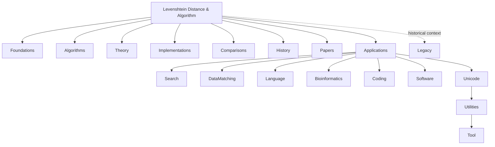

# Sơ đồ kiến trúc tri thức — Levenshtein V2

Snapshot: 528b3f6539411d1629164ddd7460d6a4ac0fafb3

**Củng cố entity và nối entity.** Phân vai ban đầu đối chiếu nguồn HTML, không phải chứng nhận đọc phản biện thủ công toàn văn. Không tự động đổi URL, nội dung hay tool.

## Core (1 trang)

| URL | Nhiệm vụ đề xuất | H1 thực tế | Từ trích xuất |
| --- | --- | --- | --- |
| / | Định nghĩa Levenshtein Distance chuẩn và thuật toán; thực thể trung tâm | The Levenshtein-Algorithm | 412 |

## Foundations (6 trang)

| URL | Nhiệm vụ đề xuất | H1 thực tế | Từ trích xuất |
| --- | --- | --- | --- |
| /approximate-string-matching | Bài toán tìm chuỗi gần đúng | Approximate String Matching: Algorithms, Models & Search | 2324 |
| /edit-distance | Họ mô hình edit distance tổng quát | Edit Distance: Definition, Algorithms, Complexity & Applications | 2230 |
| /edit-operations | Phép sửa và edit script | Edit Operations & Edit Scripts: Insertion, Deletion, Substitution | 2702 |
| /foundations | Hub nền tảng | Foundations of Levenshtein Distance | 191 |
| /glossary | Tra cứu thuật ngữ | Levenshtein & Edit Distance Glossary: Terms and Definitions | 5224 |
| /string-metrics | Tiên đề metric và phép đo chuỗi | String Metrics: Distances, Similarities & Metric Properties | 3229 |

## Algorithms (7 trang)

| URL | Nhiệm vụ đề xuất | H1 thực tế | Từ trích xuất |
| --- | --- | --- | --- |
| /algorithms | Hub thuật toán | Algorithms for Levenshtein Distance | 282 |
| /landau-vishkin-algorithm | k differences và LCE | Landau–Vishkin Algorithm: Bounded Edit Distance & Approximate Matching | 7462 |
| /levenshtein-automata | Automata chấp nhận chuỗi trong ngưỡng | Levenshtein Automata: Finite-State Fuzzy String Matching | 8156 |
| /masek-paterson-algorithm | Four Russians | Masek–Paterson Algorithm: Four Russians Edit Distance | 7771 |
| /myers-bit-vector-algorithm | Bit-parallel | Myers Bit-Vector Algorithm: Bit-Parallel Edit Distance | 8141 |
| /ukkonen-algorithm | Threshold và banded computation | Ukkonen Algorithm: Banded, Output-Sensitive Edit Distance | 5779 |
| /wagner-fischer-algorithm | Quy hoạch động và recurrence | Wagner–Fischer Algorithm: Dynamic Programming for Edit Distance | 5689 |

## Theory (11 trang)

| URL | Nhiệm vụ đề xuất | H1 thực tế | Từ trích xuất |
| --- | --- | --- | --- |
| /approximate-edit-distance-algorithms | Xấp xỉ giá trị khoảng cách, không phải tìm chuỗi gần đúng | Approximate Edit Distance Algorithms: Theory, Bounds & Complexity | 7393 |
| /bounded-and-parameterized-edit-distance | Mô hình ngưỡng k và độ phức tạp tham số | Bounded & Parameterized Edit Distance: Algorithms, k Bounds & Complexity | 7733 |
| /damerau-levenshtein-distance | Transposition và OSA | Damerau–Levenshtein Distance: Transpositions, OSA & Algorithms | 7248 |
| /dynamic-online-and-streaming-edit-distance | Cập nhật động và mô hình streaming | Dynamic, Online & Streaming Edit Distance: Algorithms, Models & Bounds | 8495 |
| /edit-distance-complexity | Lower bounds và SETH | Edit Distance Complexity: Algorithms, Bounds, SETH & Parameterized Time | 7054 |
| /edit-distance-research-frontiers | Hướng nghiên cứu mở | Edit Distance Research Frontiers: Open Problems, Bounds & New Directions | 8140 |
| /edit-distance-variants | Phân loại mô hình | Edit Distance Variants: Models, Metrics and Generalizations | 7044 |
| /learned-edit-distance-and-embeddings | Metric learning và embedding | Learned Edit Distance & Embeddings: Metric Learning, Neural Models & Theory | 9720 |
| /theory | Hub lý thuyết | Edit Distance Theory | 413 |
| /tree-and-graph-edit-distance | Phép sửa cấu trúc cây và đồ thị | Tree & Graph Edit Distance: Models, Algorithms, Complexity & GED | 10133 |
| /weighted-levenshtein-distance | Chi phí có trọng số | Weighted Levenshtein Distance: Cost Models, Metrics & Algorithms | 8052 |

## Implementations (5 trang)

| URL | Nhiệm vụ đề xuất | H1 thực tế | Từ trích xuất |
| --- | --- | --- | --- |
| /implementations | Hub triển khai | Levenshtein Distance Implementations | 142 |
| /indexing-and-filtering-for-edit-distance | Chỉ mục và lọc ứng viên | Indexing and Filtering for Edit Distance: Exact Similarity Search at Scale | 3733 |
| /levenshtein-implementations | Code, correctness và memory | Levenshtein Implementations: Correctness, Memory & Performance | 3211 |
| /levenshtein-performance-engineering | Profiling và tối ưu runtime | Levenshtein Performance Engineering: CPU, SIMD, Memory & Benchmarking | 2333 |
| /unicode-and-grapheme-safe-levenshtein | Đơn vị Unicode và grapheme | Unicode & Grapheme-Safe Levenshtein: Normalization, EGCs & Correct Text Distance | 3800 |

## Comparisons (7 trang)

| URL | Nhiệm vụ đề xuất | H1 thực tế | Từ trích xuất |
| --- | --- | --- | --- |
| /comparisons | Hub lựa chọn phép đo | Levenshtein Distance Comparisons and Alternatives | 383 |
| /edit-distance-vs-set-vector-and-ngram-similarity | So sánh tập hợp vector n-gram | Edit Distance vs Set, Vector, and N-Gram Similarity: Jaccard, Cosine, Q-Grams, and Retrieval Tradeoffs | 8590 |
| /levenshtein-distance-limitations | Giới hạn mô hình | Levenshtein Distance Limitations: Where Edit Distance Fails & What to Use Instead | 2727 |
| /levenshtein-vs-damerau-and-hamming | So sánh các phép sửa | Levenshtein vs Damerau-Levenshtein and Hamming Distance: Definitions, Algorithms, Metrics, and Tradeoffs | 6818 |
| /levenshtein-vs-jaro-winkler-and-phonetic-matching | So sánh đo tên và âm vị | Levenshtein vs Jaro-Winkler and Phonetic Matching: Name Similarity, Record Linkage, and Phonetic Algorithms | 8268 |
| /levenshtein-vs-sequence-alignment | So sánh alignment và gap | Levenshtein Distance vs Sequence Alignment: Global, Local, Gap Penalties, and Biological Scoring | 9001 |
| /string-similarity-vs-semantic-similarity | Phân biệt hình thức và ngữ nghĩa | String Similarity vs Semantic Similarity: Edit Distance, Embeddings & Meaning | 3452 |

## History (3 trang)

| URL | Nhiệm vụ đề xuất | H1 thực tế | Từ trích xuất |
| --- | --- | --- | --- |
| /history-of-levenshtein-distance | Dòng thời gian phát triển | History of Levenshtein Distance: From Coding Theory to Modern Edit-Distance Algorithms | 8157 |
| /history | Hub lịch sử | History of Levenshtein Distance | 187 |
| /vladimir-levenshtein | Thực thể nhà khoa học | Vladimir Levenshtein: Biography, Coding Theory, and the Origins of Edit Distance | 8112 |

## Papers (10 trang)

| URL | Nhiệm vụ đề xuất | H1 thực tế | Từ trích xuất |
| --- | --- | --- | --- |
| /paper-backurs-indyk | Lower bound SETH | Backurs–Indyk 2015: SETH Hardness of Edit Distance, Orthogonal Vectors, and the Strongly Subquadratic Barrier | 9438 |
| /paper-landau-vishkin-1988 | Công trình k differences | Landau–Vishkin 1988: Fast String Matching with k Differences, Approximate Pattern Matching, and Error-Bounded Search | 12179 |
| /paper-levenshtein-1966 | Công trình gốc binary codes và indel | Levenshtein 1965/1966 Paper: Binary Codes, Edit Distance, and Deletion-Correcting Codes | 7953 |
| /paper-masek-paterson-1980 | Công trình cải tiến DP | Masek–Paterson 1980: Four Russians Edit Distance, Block Precomputation, and the O(n²/log n) Algorithm | 10679 |
| /paper-myers-1999 | Công trình bit-vector | Myers 1999: Bit-Vector Edit Distance, Relocatable Dynamic Programming, and Approximate String Matching | 10987 |
| /paper-navarro-2001 | Khảo sát approximate matching | Navarro 2001: A Guided Tour to Approximate String Matching, Algorithms, Filters, Automata, and Bit Parallelism | 9828 |
| /paper-schulz-mihov-2002 | Công trình automata | Schulz–Mihov 2002: Levenshtein Automata, Linear-Time Construction, and Fast Dictionary Correction | 12745 |
| /paper-ukkonen-1985 | Công trình approximate matching | Ukkonen 1985: Algorithms for Approximate String Matching, Banded DP, and Distance-Sensitive Edit Distance | 12318 |
| /paper-wagner-fischer-1974 | Công trình string-to-string correction | Wagner–Fischer 1974: The String-to-String Correction Problem, Dynamic Programming, and Edit Distance | 9324 |
| /papers | Hub nguồn nghiên cứu | Foundational Papers on Levenshtein Distance and Edit-Distance Algorithms | 518 |

## Applications (1 trang)

| URL | Nhiệm vụ đề xuất | H1 thực tế | Từ trích xuất |
| --- | --- | --- | --- |
| /applications | Hub ứng dụng liên ngành | Applications of Levenshtein Distance | 721 |

## Search (3 trang)

| URL | Nhiệm vụ đề xuất | H1 thực tế | Từ trích xuất |
| --- | --- | --- | --- |
| /fuzzy-search-at-scale | Kiến trúc retrieval quy mô lớn | Fuzzy Search at Scale: Indexing, Filtering & Exact Verification | 10327 |
| /fuzzy-search-with-edit-distance | Retrieval và ranking gần đúng | Fuzzy Search with Edit Distance: Algorithms, Thresholds & Ranking | 6745 |
| /search | Hub tìm kiếm | Search and Information Retrieval with Edit Distance | 156 |

## DataMatching (5 trang)

| URL | Nhiệm vụ đề xuất | H1 thực tế | Từ trích xuất |
| --- | --- | --- | --- |
| /data-matching | Hub đối sánh dữ liệu | Data Matching and Entity Resolution with Edit Distance | 213 |
| /entity-resolution-and-record-linkage | Liên kết bản ghi và định danh | Entity Resolution & Record Linkage with Edit Distance: Models, Blocking & Decision Rules | 5351 |
| /name-address-and-place-matching | So khớp tên địa chỉ địa danh | Name, Address & Place Matching: Normalization, Similarity & Entity Resolution | 5975 |
| /patient-identity-matching | Định danh bệnh nhân | Patient Identity Matching: Algorithms, MPI, Safety & Record Linkage | 7705 |
| /privacy-preserving-record-linkage | Bảo vệ riêng tư khi liên kết bản ghi | Privacy-Preserving Record Linkage: Bloom Filters, PSI, Secure Computation & Attacks | 8357 |

## Language (7 trang)

| URL | Nhiệm vụ đề xuất | H1 thực tế | Từ trích xuất |
| --- | --- | --- | --- |
| /language-processing | Hub xử lý ngôn ngữ | Edit Distance in Language Processing and Document Evaluation | 357 |
| /ocr-evaluation-and-post-correction | Đánh giá OCR và hậu hiệu chỉnh | OCR Evaluation and Post-Correction: Character Error Rate, Ground Truth, Error Models, and Reliable Correction | 7757 |
| /phonetic-dialect-and-language-distance | Khoảng cách âm vị phương ngữ | Phonetic, Dialect, and Language Distance: Levenshtein Methods, Dialectometry, and Linguistic Similarity | 7706 |
| /spell-and-query-correction | Sửa lỗi và ranking truy vấn | Spell & Query Correction with Edit Distance: Models, Ranking & Search | 5044 |
| /text-normalization-and-transliteration | Chuẩn hóa và chuyển tự | Text Normalization and Transliteration: Unicode, Edit Distance, and Reliable Matching | 3075 |
| /translation-edit-rate-and-mt-evaluation | TER và đánh giá dịch máy | Translation Edit Rate (TER) and Machine Translation Evaluation: Alignment, Shifts, HTER, Metrics, and Limitations | 4906 |
| /word-error-rate-and-asr-evaluation | WER và đánh giá ASR | Word Error Rate (WER) and ASR Evaluation: Mathematics, Alignment, Protocols, and Limitations | 5823 |

## Bioinformatics (5 trang)

| URL | Nhiệm vụ đề xuất | H1 thực tế | Từ trích xuất |
| --- | --- | --- | --- |
| /bioinformatics | Hub sinh học | Edit Distance in Bioinformatics and Sequence Analysis | 287 |
| /edit-distance-in-bioinformatics | Tổng quan chuỗi sinh học | Edit Distance in Bioinformatics: Sequence Alignment, Biological Models, Algorithms, and Limits | 7602 |
| /edit-distance-in-dna-storage | Lỗi indel và reconstruction DNA | Edit Distance in DNA Storage: Indel Channels, Synchronization Codes, Reconstruction, and Error Correction | 9368 |
| /edit-distance-in-genomic-search-and-read-mapping | Seed index alignment read mapping | Edit Distance in Genomic Search and Read Mapping: Seeds, Indexes, Alignment, and Mapping Quality | 9309 |
| /sequence-alignment-and-gap-models | Global local affine gap | Sequence Alignment and Gap Models: Global, Local, Affine, and Biological Alignment Theory | 7741 |

## Coding (4 trang)

| URL | Nhiệm vụ đề xuất | H1 thực tế | Từ trích xuất |
| --- | --- | --- | --- |
| /coding-theory | Hub mã sửa lỗi | Levenshtein Distance in Coding Theory and Synchronization Codes | 240 |
| /insertion-deletion-codes-and-synchronization-errors | Kênh lỗi đồng bộ và decoding | Insertion-Deletion Codes and Synchronization Errors: Theory, Constructions, Bounds, and Decoding | 9042 |
| /levenshtein-in-coding-theory | Ứng dụng kênh indel | Levenshtein Distance in Coding Theory: Indel Channels, Synchronization Errors, and Error-Correcting Codes | 9446 |
| /varshamov-tenengolts-and-levenshtein-codes | VT syndrome và single deletion | Varshamov-Tenengolts and Levenshtein Codes: Single-Deletion Theory, VT Syndromes, Decoding, and Optimality | 7905 |

## Software (5 trang)

| URL | Nhiệm vụ đề xuất | H1 thực tế | Từ trích xuất |
| --- | --- | --- | --- |
| /log-and-event-sequence-similarity | Trace alignment và log | Log and Event-Sequence Similarity: Edit Distance, Trace Alignment, Anomaly Detection, and Observability | 5168 |
| /software-systems | Hub hệ thống phần mềm | Edit Distance in Software Systems and Security | 319 |
| /source-code-and-ast-similarity | So sánh AST và mã nguồn | Source Code and AST Similarity: Edit Distance, Clone Detection, Tree Differencing, and Semantic Limits | 9131 |
| /typosquatting-and-supply-chain-security | Phát hiện giả mạo tên package | Typosquatting and Software Supply-Chain Security: Edit Distance, Package Impersonation, Detection, and Defense | 2229 |
| /unicode-homoglyph-and-confusable-attacks | Unicode confusables và IDN | Unicode Homoglyph and Confusable Attacks: Edit Distance, UTS #39, IDN Spoofing, and Defense | 2035 |

## Unicode (2 trang)

| URL | Nhiệm vụ đề xuất | H1 thực tế | Từ trích xuất |
| --- | --- | --- | --- |
| /styled-unicode-text | Styled Unicode không phải font CSS | Styled Unicode Text: Characters, Symbols & String Transformation \| Levenshtein.net | 1951 |
| /unicode-text-transformations | Biến đổi Unicode; cầu nối kỹ thuật | Unicode Text Transformations & Edit Distance \| Levenshtein.net | 2117 |

## Utilities (2 trang)

| URL | Nhiệm vụ đề xuất | H1 thực tế | Từ trích xuất |
| --- | --- | --- | --- |
| /text-tools | Hub công cụ chuỗi | Text Tools | 639 |
| /unicode-text-tools | Hub công cụ biến đổi Unicode theo locale | Unicode Text Tools | 486 |

## Legacy (7 trang)

| URL | Nhiệm vụ đề xuất | H1 thực tế | Từ trích xuất |
| --- | --- | --- | --- |
| /about.htm | Thông tin pháp lý lịch sử | About | 51 |
| /levenshtein_faq.htm | FAQ lịch sử | Levenshtein-FAQs | 72 |
| /levenshtein_feedback.htm | Phản hồi | Feedback | 50 |
| /levenshtein_implementation.htm | Triển khai lịch sử, khác bài hiện đại | Implementing the Levenshtein Algorithm | 88 |
| /levenshtein_links.htm | Danh mục tham khảo lịch sử | Levenshtein-Links | 5656 |
| /levenshtein_search.htm | Fault-tolerant search lịch sử | Fault-tolerant search | 632 |
| /privacy.htm | Chính sách riêng tư | Datenschutzerklärung | 295 |

## Tool (17 trang)

| URL | Nhiệm vụ đề xuất | H1 thực tế | Từ trích xuất |
| --- | --- | --- | --- |
| /fancy-text-generator | Công cụ styled Unicode theo locale; không đồng nhất với thuật toán edit distance | Fancy Text Generator | 7851 |
| /schriftgenerator | Công cụ styled Unicode theo locale; không đồng nhất với thuật toán edit distance | Schriftgenerator | 3505 |
| /generador-de-letras | Công cụ styled Unicode theo locale; không đồng nhất với thuật toán edit distance | Generador de Letras | 7864 |
| /letras-diferentes | Công cụ styled Unicode theo locale; không đồng nhất với thuật toán edit distance | Letras Diferentes | 7913 |
| /font-henkan | Công cụ styled Unicode theo locale; không đồng nhất với thuật toán edit distance | フォント変換 | 8465 |
| /krasivyy-shrift | Công cụ styled Unicode theo locale; không đồng nhất với thuật toán edit distance | Красивый шрифт | 886 |
| /ki-tu-dac-biet | Công cụ styled Unicode theo locale; không đồng nhất với thuật toán edit distance | Font Chữ Đẹp | 9305 |
| /letras-bonitas | Công cụ styled Unicode theo locale; không đồng nhất với thuật toán edit distance | Letras Bonitas | 8119 |
| /yazi-stilleri | Công cụ styled Unicode theo locale; không đồng nhất với thuật toán edit distance | Yazı Stilleri; Yazı Stilleri – 300+ Stil, Sembol, Instagram Biyografi ve Oyun Nickleri | 575 |
| /font-style | Công cụ styled Unicode theo locale; không đồng nhất với thuật toán edit distance | Font Style; Font Style – 300+ Unicode Styles, Symbols, Instagram Bios and Game Names | 833 |
| /te-shu-zi-ti | Công cụ styled Unicode theo locale; không đồng nhất với thuật toán edit distance | 特殊字體; 特殊字體 – 300+ Unicode 字體樣式、特殊符號、Instagram 自介與遊戲名稱 | 218 |
| /caratteri-speciali | Công cụ styled Unicode theo locale; không đồng nhất với thuật toán edit distance | Caratteri Speciali; Caratteri Speciali – 300+ stili Unicode, simboli, bio Instagram e nomi per giochi | 904 |
| /akson-phiset | Công cụ styled Unicode theo locale; không đồng nhất với thuật toán edit distance | อักษรพิเศษ | 279 |
| /font-aesthetic | Công cụ styled Unicode theo locale; không đồng nhất với thuật toán edit distance | Font Aesthetic | 943 |
| /lettertypes | Công cụ styled Unicode theo locale; không đồng nhất với thuật toán edit distance | Lettertypes; Lettertypes – 300+ Unicode-stijlen, symbolen, Instagram-bio’s en gamenamen | 919 |
| /police-d-ecriture | Công cụ styled Unicode theo locale; không đồng nhất với thuật toán edit distance | Police d'Écriture | 1066 |
| /generator-czcionek | Công cụ styled Unicode theo locale; không đồng nhất với thuật toán edit distance | Generator Czcionek; Generator Czcionek – 300+ stylów Unicode, symbole, bio Instagram i nazwy do gier | 860 |

## Ranh giới

Trang chủ sở hữu Levenshtein chuẩn; edit-distance sở hữu họ mô hình. Approximate matching khác xấp xỉ giá trị khoảng cách. Bài thuật toán khác paper. Unicode generator không phải thuật toán edit distance. Duyệt nhiệm vụ từng bài bằng headings, lead, schema và toàn văn đã trích xuất.
